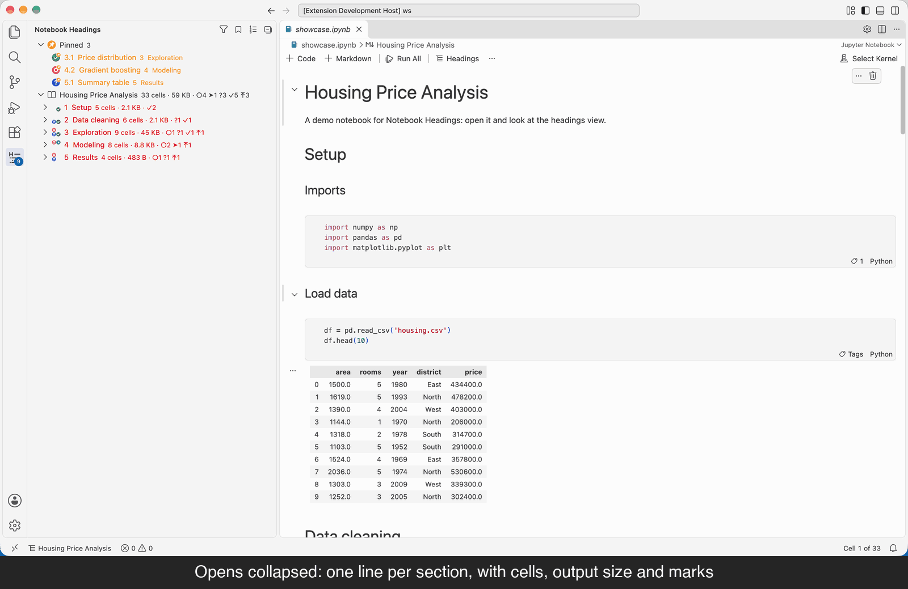
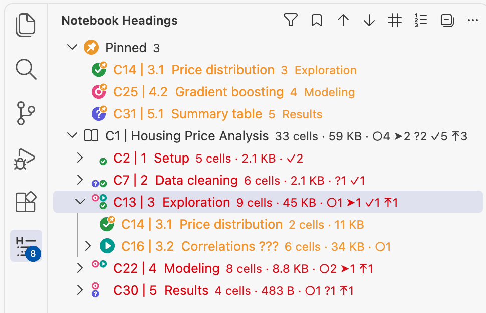
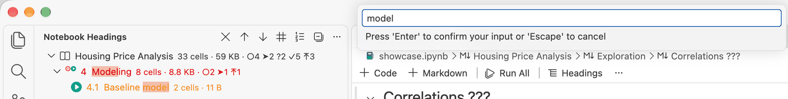
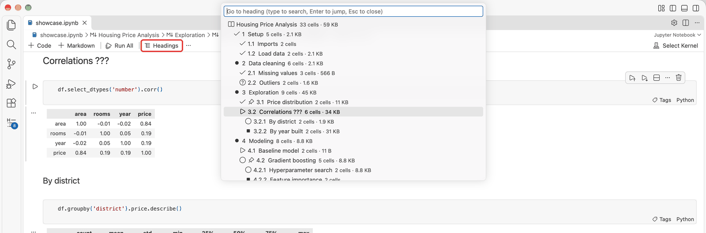
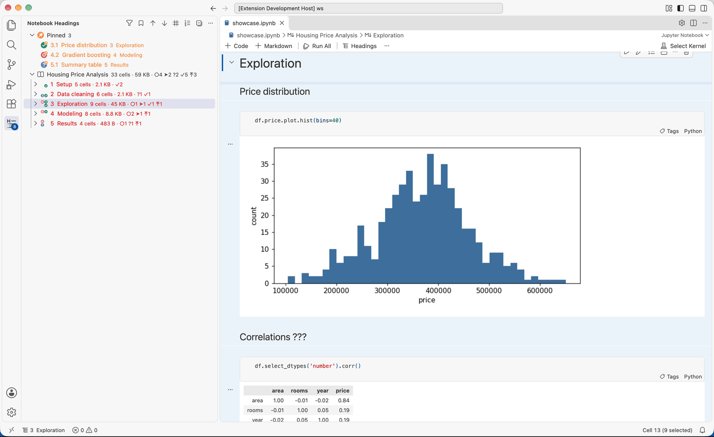
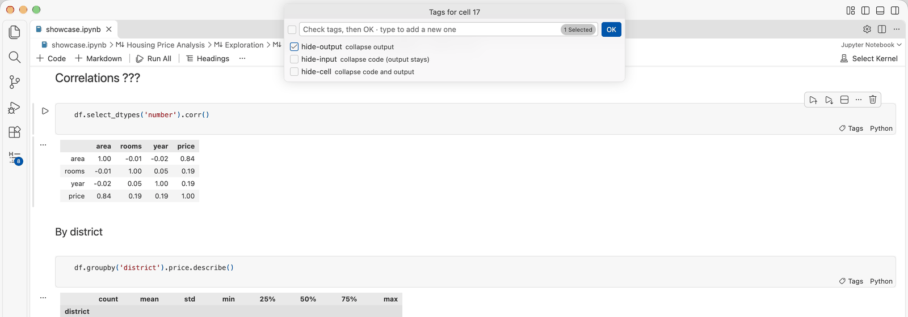
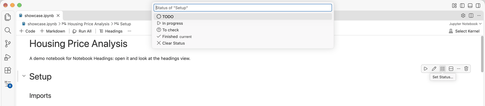
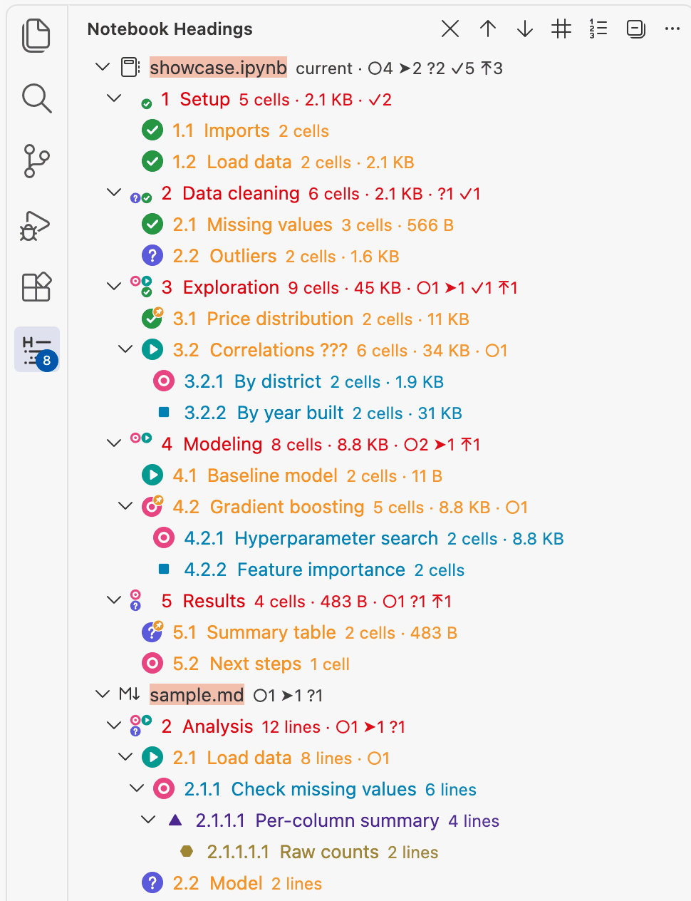
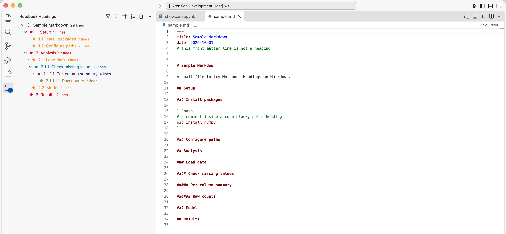
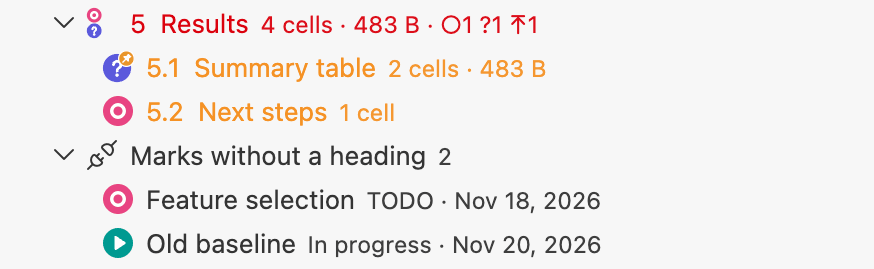

# Notebook Headings

[中文说明](README.zh-CN.md)

A heading outline for **Jupyter notebooks** and **Markdown files** in VS Code,
built for long documents with hundreds of headings.

VS Code's built-in Outline expands everything, which is unusable for a
notebook with 1,000+ headings. Notebook Headings keeps all six heading levels
but opens the tree expanded only to the level you choose (default: `##`), so
you see the structure first and drill down on demand.



## Quick start

- **Install:** search for "Notebook Headings" in the VS Code Extensions view,
  or open its [Marketplace page](https://marketplace.visualstudio.com/items?itemName=cuihuaxia.notebook-headings)
  (see [Installation](#installation)).
- **Share it:** send the Marketplace link (see [Sharing](#sharing)).
- **Build from source or contribute:** see [CONTRIBUTING.md](CONTRIBUTING.md).

## Features

- **Opens collapsed to a chosen level.** All headings are kept; deeper ones
  just start collapsed. *Collapse to Default Level* restores this view at any
  time.
- **Outline numbers** (`1`, `1.2`, `1.2.3`). A single `#` title is left
  unnumbered so the sections start at 1. Toggle from the view toolbar.
- **Level colors and shapes.** `##` red ●, `###` orange ◆, `####` blue ■,
  `#####` purple ▲, `######` olive ⬢, with separate light and dark theme
  colors. Every color can be overridden.
- **Section lengths and output sizes.** The grey text after a heading shows
  how long the section is — cells in a notebook, lines in a Markdown file —
  and, for notebooks, how much output it stores, e.g. `34 cells · 2.1 MB`, so
  you can spot the sections that make a notebook large or slow to render.
- **Cell and line numbers (optional).** Click **#** in the view's toolbar
  (or turn on `notebookHeadings.showPosition`) to start each heading with where its
  section begins, e.g. `C14 │ 3.1  Summary` (cell 14, as in the status bar's
  "Cell 14 of 33") or `L26 │` (line 26) in Markdown, so you can match the
  tree with cell or line numbers at a glance.
  <br>
- **Follows the cursor.** Clicking or scrolling in the document highlights the
  current section without expanding anything you collapsed.
- **Status bar** shows the current section; hover for the full path, click to
  open the view.
- **Filter** (`Cmd+Alt+F` / `Ctrl+Alt+F` in the view): live search with match
  highlighting; matches keep their parent headings visible.
  <br>
- **Go to Heading** (the **Headings** button at the top of a notebook or
  Markdown editor, or `Cmd+K` then `H` / `Ctrl+K` then `H`): a searchable
  list of all headings, also when the view is closed.
  <br>
- **Select whole sections** (right-click → **Select Section**): selects the
  heading's cells, or lines in Markdown, including all its subsections, so
  you can cut, copy, move, run or delete the section with VS Code's own
  commands. Select several headings first (`Cmd`/`Ctrl`-click or
  `Shift`-click) to select all their sections at once.
  <br>
- **Right-click to copy** a heading's text, a **section reference** with its
  file, full path and cell range (e.g.
  `code/Analysis.ipynb · 2  Analysis › 2.1  Summary · cells 12–30`; handy for
  AI chats such as Claude Code, which see selected text but not selected
  cells), or the **section's content** as plain text.
- **English and Chinese interface.** Commands, menus, settings and messages
  follow VS Code's display language.
- **One-click cell tags.** A **Tags** button at the bottom right of every
  code cell opens a short checklist of the tags that collapse parts of the
  cell behind a click-to-show toggle in Jupyter Book / MyST pages:
  `hide-output`, `hide-input` and `hide-cell`. Any other tag can be typed in.
  Tags are stored where Jupyter, Jupyter Book and nbconvert read them.
  <br>
- **Status marks.** Right-click a heading → **Set Status…** to mark it TODO,
  In progress, To check or Finished; a colored status icon replaces its
  level shape. Headings containing `???` count as To check
  automatically. In a notebook, the toolbar that appears over a Markdown
  cell also has **Set Status…** for the cell's heading, with Clear Status.
  The tooltip says since when a heading has its status. **↑ ↓** in the
  view's toolbar (`Cmd+K` then `B` / `N`) jump to the previous or next
  heading still to do, in progress or to check; **Copy Marks as Checklist**
  (in the toolbar's `…` menu) copies the project's statuses as a Markdown
  checklist, to paste into your notes.
  <br>
- **Pin to top.** **Pin to Top** puts a gold pin icon before a heading and
  lists it in a **Pinned** group at the top of the view, one click away.
- **Marks stay visible when collapsed.** Every parent sums up the marks below
  it, e.g. `○2 ➤1 ✓3 ⤒2` (○ TODO, ➤ In progress, ? To check, ✓ Finished,
  ⤒ pinned), and the bookmark button lists the marked sections of every
  document in the project, by file.
  Marks are kept in the project, not in your documents, so they follow you
  to another computer.
  <br>
- **Clear a section's outputs** (right-click → **Clear Section Outputs…**):
  the output sizes show which sections make a notebook large; clear them in
  one step, after a confirmation, and undo with `Cmd+Z` if needed.
- **Safe by design.** The extension never changes your code or text, and
  changes a notebook only when you ask it to: a cell's tags (cell metadata)
  or clearing a section's outputs after confirming, each undoable with
  `Cmd+Z`. Marks never touch your documents.

Markdown parsing ignores YAML front matter, fenced code blocks and HTML
comments, so `# comments` inside code and headings commented out are never
mistaken for headings. Underlined (setext) headings are recognised too.



## Installation

### From the VS Code Marketplace (recommended)

Extensions view → search for **Notebook Headings** → **Install**, or run:

```bash
code --install-extension cuihuaxia.notebook-headings
```

If `code` is not on your PATH, run **Shell Command: Install 'code' command in
PATH** from the VS Code command palette first (macOS), or use the full path,
e.g. `"/Applications/Visual Studio Code.app/Contents/Resources/app/bin/code"`.

Then run **Developer: Reload Window**. A new icon (an "H" with list lines)
appears in the activity bar.

Requires VS Code 1.80 or newer. Works with any notebook opened by the
Jupyter extension, whatever the kernel (Python, R, …).

### From a packaged file

Each version's package is attached to its
[GitHub Release](https://github.com/CuihuaXia/notebook-headings/releases) and
kept in [`releases/`](releases/). Extensions view → `…` menu (top right) →
**Install from VSIX…** → choose the `.vsix`, or:

```bash
code --install-extension releases/notebook-headings-<version>.vsix
```

Use this only when the Marketplace is not reachable: an extension installed
from a VSIX is not synced by Settings Sync and is not updated automatically.

To build from source, see [CONTRIBUTING.md](CONTRIBUTING.md).

## Moving to another machine

- With **Settings Sync** on, an extension installed from the Marketplace is
  installed and kept up to date on every synced machine automatically.
- Without it, install from the Marketplace once on each machine.
- Your own color, shortcut and other settings live in VS Code's
  `settings.json` / `keybindings.json`, not in this repository; Settings Sync
  carries them too.

## Sharing

Send the [Marketplace link](https://marketplace.visualstudio.com/items?itemName=cuihuaxia.notebook-headings),
or tell people to search for "Notebook Headings" in the Extensions view.
Bug reports and suggestions go to
[GitHub Issues](https://github.com/CuihuaXia/notebook-headings/issues).

## Usage

1. Open a `.ipynb` or `.md` file.
2. Click the Notebook Headings icon in the activity bar.
3. Click a heading to jump to it.

View toolbar, left to right:

| Button | Action |
| --- | --- |
| Filter Headings (funnel) | Type to filter; Enter keeps the filter, Esc cancels. Turns into ✕ (Clear Filter) while filtering. |
| Show Marked Headings (bookmark) | The marked headings (pinned or with any status) of every notebook and Markdown file in the project, grouped by file with the current one first; each with its whole section expanded. Click a heading in another file to open it there. ✕ goes back. |
| ↑ ↓ Go to Previous / Next Mark | Jump to the previous or next heading of the current document that is TODO, In progress or To check, starting over at the end. Shown when there is one. |
| # Toggle Cell and Line Numbers | Show or hide where each section starts (`C14 │`, `L26 │`); the same as the `showPosition` setting. |
| 1≡ Toggle Heading Numbers | Show or hide outline numbers. |
| ⊟ Collapse to Default Level | Restore the default expansion. |
| `…` → Copy Marks as Checklist | Every heading with a status in the project, as a Markdown checklist grouped by file (Finished ones ticked), with since when. |

Right-click a heading for:

- **Set Status…**: TODO, In progress, To check or Finished (and Clear
  Status, when the heading has a status you set). A heading whose text
  contains `???` counts as To check until you set another status or remove
  the `???`.
- **Clear Status**: shown on headings with a status you set.
- **Pin to Top** / **Unpin**: pinned headings are listed in the **Pinned**
  group at the top of the view; click one to jump there.
- **Select Section**: selects every cell (notebook) or line (Markdown) of the
  section, subsections included, and moves focus to the editor. Then use
  `Cmd+X` / `Cmd+V` to move it, `Cmd+C` to copy it, or run or delete the
  selected cells. If the heading shares its first cell with an earlier
  heading, that cell is selected too and the status bar says so.
- **Edit Section Tags…** (notebooks): opens the tag checklist for every code
  cell of the section, subsections included, e.g. to add `hide-output` to a
  whole analysis section in one go. Heading and text cells are left alone, so
  the section stays readable on the page.
- **Copy Heading Text**.
- **Copy Section Reference**: the file, heading path and cell range (line
  range in Markdown), e.g.
  `code/Analysis.ipynb · 2  Analysis › 2.1  Summary · cells 12–30`. Paste it
  into an AI chat such as Claude Code to refer to that section; these tools
  see selected text but not selected cells.
- **Copy Section Content**: every cell (or line) of the section as plain text;
  code cells are wrapped in ```` ``` ```` fences with their language.
- **Clear Section Outputs…** (notebooks): removes the outputs of every code
  cell in the section, subsections included, after asking (the question names
  the number of cells and their size). Code, tags and execution counts stay;
  `Cmd+Z` brings the outputs back. Use the output sizes in the tree to find
  the sections worth clearing.

Select several headings with `Cmd`/`Ctrl`-click or `Shift`-click, then
right-click one of them: **Set Status…**, **Clear Status** and the pin
commands mark all of them, **Clear Section Outputs…** clears all of them, **Select Section** selects all their sections at once (nested or
adjacent sections are merged, so no cell is selected twice), **Edit Section
Tags…** tags the code cells of all of them, and the copy commands copy one
line per heading (Copy Section Content: one block of text), in document
order.

To tag a cell, click **Tags** at the bottom right of the cell (it shows the
number of tags once there are some), check or uncheck tags, or type a new one,
then press Enter. Typing filters the list (`hide` shows `hide-input`,
`hide-output`, …); text that matches no listed tag is added as a new tag.
**Notebook Headings: Edit Cell Tags…** in the command palette does the same
for the selected cell. Markdown cells show the button only once they have
tags.

To tag several cells at once, select them first (for example with **Select
Section**), then click **Tags** on any of them or use the command palette; the
selected code cells are tagged (Markdown cells are skipped). A tag
that every selected cell has starts checked (uncheck it to remove it from all);
a tag that only some cells have is marked "3/10 cells" and stays as it is
unless you check it (which adds it to all). The whole change is one `Cmd+Z`.

Keyboard shortcuts (change them in *Keyboard Shortcuts* by searching
"Notebook Headings"):

| Shortcut (macOS / Windows, Linux) | Where | Command |
| --- | --- | --- |
| `Cmd+K` then `H` / `Ctrl+K` then `H` | a notebook or Markdown file is open (focus in the editor or in the headings view) | Go to Heading… |
| `Cmd+K` then `N` / `Ctrl+K` then `N` | same | Go to Next Mark |
| `Cmd+K` then `B` / `Ctrl+K` then `B` | same | Go to Previous Mark |
| `Cmd+Alt+F` / `Ctrl+Alt+F` | Notebook Headings view | Filter Headings |

## Settings

| Setting | Default | Description |
| --- | --- | --- |
| `notebookHeadings.defaultExpandLevel` | `2` | Deepest heading level visible when a document opens (1–6). |
| `notebookHeadings.numbering` | `true` | Show outline numbers. |
| `notebookHeadings.numberH1` | `false` | Also number `#` headings. |
| `notebookHeadings.levelColors` | `true` | Color headings and icons by level. |
| `notebookHeadings.showPosition` | `false` | Show where each section starts, before each heading: `C14 │` (cell number) in notebooks, `L26 │` (line) in Markdown. |
| `notebookHeadings.showCellCount` | `true` | Show the length of each section: cells in a notebook, lines in a Markdown file. |
| `notebookHeadings.showOutputSize` | `true` | Show the total output size of each notebook section. |
| `notebookHeadings.followCursor` | `true` | Highlight the current section in the tree. |
| `notebookHeadings.statusBar` | `true` | Show the current section in the status bar. |
| `notebookHeadings.cellTagButton` | `true` | Show the Tags button on code cells. |
| `notebookHeadings.markdown` | `true` | Also handle Markdown files. |
| `notebookHeadings.toCheckMarkers` | `["???", "？？？"]` | Text that makes a heading show as To check; `[]` turns it off. |

### Status marks and pins

| Icon | Status | In summaries |
| --- | --- | --- |
| pink circle with a ring | TODO | `○` |
| teal circle with a play arrow | In progress | `➤` |
| indigo circle with a question mark | To check (also any heading containing `???`) | `?` |
| green circle with a check | Finished | `✓` |
| gold circle with a pin | Pinned (a small pin over a status icon) | `⤒` |

A first-level section that holds statuses shows them as a 2×2 grid of small
icons instead: top left TODO, top right In progress, bottom left To check,
bottom right Finished. **Show Marked Headings** shows every heading that is
pinned or has any status, Finished included, with its whole section expanded,
in every notebook and Markdown file of the project (the folder that holds the
marks file); headings with `???` are found in files that are not open, too.
The number on the view's icon in the activity bar counts the headings still
TODO or To check in the whole project. Online-only files of a cloud drive
are not downloaded to look for `???` (only marks already set in them are
shown), and a document outside your workspace folders has its folder
searched only when you click the bookmark.

### Where marks are stored

Marks are not written into your documents. They are kept in
`.vscode/notebook-headings.json` in the project (the git repository or
workspace folder holding the document, or else its own folder), by relative
path. Keep that file with the project —
commit it, or sync the folder with a cloud drive — and your marks are there
on any computer.

- **If git ignores that file** (e.g. a `.vscode/` line in `.gitignore`), the
  extension tells you once per project; **Fix .gitignore** adds the lines that
  let git keep just this file. By hand:
  `!/.vscode/`, `/.vscode/*` and `!/.vscode/notebook-headings.json` (only the
  last one if the whole `.vscode` folder is not ignored).
- **Documents that git ignores** keep their marks on this computer only, so a
  private file's path and headings never reach the repository. (So do files
  of a git repository that is not open as a workspace folder.)
- Renaming, moving or deleting a document in VS Code updates its marks, and
  changes that arrive with a `git pull` show up right away.
- A mark stays with its heading: adding or editing other headings does not
  move it, renaming the heading in VS Code keeps it, a copy of the heading
  gets no mark, and deleting the heading takes its mark off the tree (pasting
  the heading back brings it back).
- In notebooks whose cells have ids (nbformat 4.5, the format of recent
  Jupyter and VS Code), a mark is tied to its cell, so it also stays when the
  heading is renamed elsewhere: in another editor, or by a `git pull`.
- A mark whose heading is gone is not thrown away: Show Marked Headings lists
  it under **Marks without a heading** in its file. Click it to move it to a
  heading (it keeps its status and date), or right-click → **Remove Mark**.
  <br>
- If a merge leaves conflict markers in the file, marks are paused until you
  resolve them; the file is never overwritten.
- Marks that version 1.5 saved inside notebook cells still work, and move to
  the file the next time you change them.

### Custom colors

Colors are theme colors, so they can be overridden in `settings.json`.
`level1` is the shallowest non-title level (usually `##`):

```json
"workbench.colorCustomizations": {
  "notebookHeadings.level1Foreground": "#DC1D04",
  "notebookHeadings.level2Foreground": "#F29F05",
  "notebookHeadings.level3Foreground": "#048ABF",
  "notebookHeadings.level4Foreground": "#5B2A9E",
  "notebookHeadings.level5Foreground": "#A69232",
  "notebookHeadings.level6Foreground": "#B3B3B3"
}
```

To set colors for one theme only, nest them under the theme name, e.g.
`"[Default Dark Modern]": { "notebookHeadings.level1Foreground": "#FF6B4A" }`.

## How levels are counted

- If a document has exactly one `#` heading, it is treated as the page title:
  default color, book icon, no number.
- Every other heading is ranked relative to the shallowest remaining level.
  In a typical notebook that means `##` = level 1 (red), `###` = level 2, …
- Skipped levels are fine: a `####` directly under a `##` becomes its child.
- For notebooks, a section's cell count runs from its heading's cell to the
  next heading of the same or a higher level.

## Known limitations

- VS Code does not let extensions change font size or weight in tree views,
  so levels are distinguished by color, icon shape and indentation only.
- ATX headings (`#`, `##`, …) and underlined (setext, `===` / `---`)
  headings are recognised, but not HTML `<h2>` tags. Headings inside fenced
  code blocks and HTML comments (`<!-- … -->`) are ignored.
- A notebook cell can hold several headings, but the cursor and the scroll
  position are known only to the cell: when you move through the notebook,
  the tree and status bar show the cell's last heading (or the one you just
  clicked).
- Label colors rely on VS Code's file-decoration mechanism, which is why every
  heading has an icon in front of it.
- The grey text after a heading can only hold plain text, so mark summaries
  use symbols (`○ ➤ ? ✓ ⤒`) rather than the colored icons.
- Marks (see [Where marks are stored](#where-marks-are-stored)) cannot be
  undone with `Cmd+Z`, and are lost when a document is renamed outside VS
  Code (Finder, `git mv`). In Markdown files and in older notebooks without
  cell ids, a heading renamed outside VS Code (e.g. by a `git pull`) loses its
  mark until you move it back from **Marks without a heading**.

## Contributing

Bug reports and pull requests are welcome. See
[CONTRIBUTING.md](CONTRIBUTING.md) for building from source, debugging and the
project layout.

## License

[MIT](LICENSE) © 2026 Cuihua Xia
